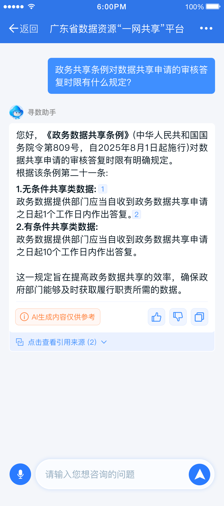

# "一网共享"平台 AI 助手 · 移动端设计图集

广东省数据资源"一网共享"平台 AI 助手（寻数助手）的移动端高保真设计稿，覆盖从对话入口、语音交互、会话管理到答案溯源的完整闭环，共 25 张。

## 首页与核心场景

首页采用「助手形象 + 四大能力入口」的结构：智能寻数、案例推荐、政策解读、操作指引。四类场景各配一张预置提问卡片，解决"不知道怎么问"的冷启动问题。

## 设计覆盖的交互闭环

| 模块 | 设计图 | 说明 |
|---|---|---|
| 对话入口 | 01-首页 / 02-入口 / 03-小头像 | 平台内多处唤起 AI 助手 |
| 语音交互 | 04-语音交互 → 05-语音切换 → 06-识别中 → 07-识别完成 → 08-转文字 → 09-取消 | 按住说话、语音/文字双通道、识别状态流转 |
| 会话管理 | 10-弹窗 → 11-新建对话 / 12-重命名对话 / 13-命名和删除 / 14-删除对话 | 多轮会话的组织与维护 |
| 答案可信度 | 15/16/17-来历和评价 | **引用来源展示 + 点赞/点踩反馈**，AI 生成内容显式标注"仅供参考" |
| 多端适配 | 18/19/20-折叠屏效果 | 折叠屏展开态的双栏布局（会话列表 + 对话区） |
| 其他 | 21-客服 | 转人工客服兜底 |

## 答案溯源设计（重点）

政务问答的可信度是第一优先级，为此答案区固定了三件套：

1. **引用来源**——答案底部展示"点击查看引用来源 (N)"，可展开追溯每条结论出自哪份政策/目录；
2. **AI 标注**——"AI 生成内容仅供参考"角标常驻，不做结论性暗示；
3. **反馈闭环**——点赞/点踩 + 复制，点踩结果回流到评测体系。

## 与工程的衔接

- 这套设计稿对应的问答后端为多工具路由架构（意图识别 → 工具检索 → 答案整合），配套的评测体系见 [agent-log-evaluator](https://github.com/wusiyi541/agent-log-evaluator)；
- 点赞/点踩与引用来源的设计，后来直接落地为平台功能。
