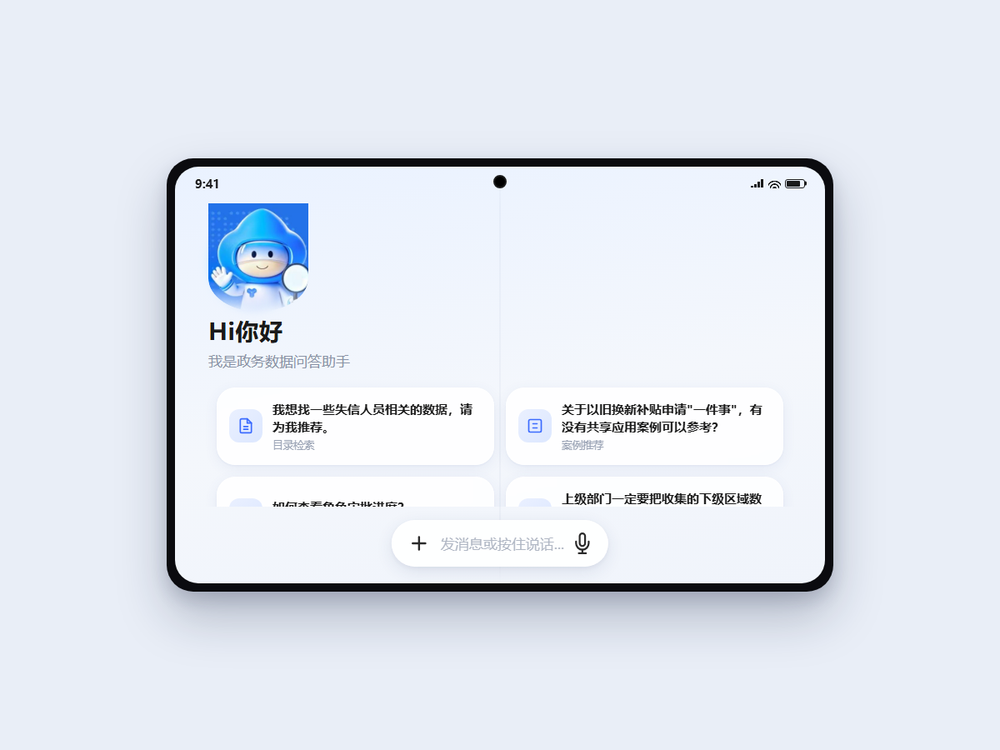

# 政务数据问答助手 · 移动端对话界面原型（gov-ai-assistant-prototype）

一套为「政务数据问答助手」设计的高保真移动端对话界面原型，纯静态 HTML/CSS/JS 实现，浏览器直接打开即可交互预览。


## 背景与定位

政务数据共享平台的对话式入口，需要同时满足三类高频诉求：

- **目录检索**——"我想找 XX 数据，该申请哪个目录？"
- **案例推荐**——"其他单位有没有做过类似的数据共享？"
- **操作指引**——"权限怎么申请？审批进度在哪看？"

本原型是这一入口的**设计基线**：先在真机观感上对齐语音输入、场景化推荐、帮助引导等关键交互，再进入工程开发，避免"开发完再改交互"的高成本返工。

## 界面亮点

- **375×812 手机框预览**：原型按真机尺寸 1:1 还原，方便在评审会上投屏讨论
- **语音优先的输入设计**：输入框支持"发消息或按住说话"双通道，贴合政务用户移动端使用习惯
- **场景化推荐问题卡片**：按目录检索/案例推荐/操作指引三类场景预置提问入口，降低"不知道怎么问"的冷启动门槛
- **品牌形象承载**：助手 IP 形象 + 光晕动效，强化"有人格的服务"感知
- **折叠屏/方形屏适配**：`index-square.html` 提供方形屏布局方案（双栏卡片+底部悬浮输入），覆盖政务终端多样化形态



## 文件结构

```
├── index.html          手机端主页（375×812 手机框）
├── index-square.html   折叠屏/方形屏布局方案
├── styles.css          手机端样式（8px 圆角卡片体系）
├── styles-square.css   方形屏样式
├── script.js           交互脚本（按压反馈、语音按钮态、帮助弹窗）
└── assets/             助手形象素材
```

## 本地预览

无需构建，直接双击 `index.html`，或：

```bash
# 推荐用本地服务预览（避免部分浏览器对本地字体的限制）
python -m http.server 8080
# 打开 http://localhost:8080
```

## 设计规范

- 中文 UI 文案，界面语言面向非技术政务用户
- 统一 8px 圆角卡片体系，浅色底、低饱和主色，贴合政务视觉基调
- 交互状态（按压/悬停/语音录制）均有视觉反馈

## 说明

- 原型为前端高保真演示，未接入后端服务
- 界面中的提问示例均为通用演示内容
